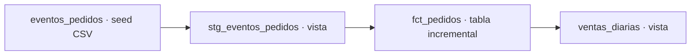

# dbt + Snowflake · Ventas diarias

Simulador de una tarea habitual de **Analytics Engineering**: mantener un informe diario fiable cuando los pedidos llegan tarde, se corrigen o se cancelan. El proyecto usa **dbt Core real** y ejecuta el SQL en **DuckDB** para simular localmente el papel de Snowflake. Puedes probarlo sin cuenta, credenciales ni costes de Snowflake. Incluye un perfil opcional para ejecutar los mismos modelos en una cuenta real.

[](https://github.com/beabustor/dbt-snowflake/actions/workflows/ventas-diarias.yml)

## ¿Para qué sirven dbt y Snowflake?

| Herramienta | Papel en el flujo |
| --- | --- |
| **Snowflake** | Almacena los datos y ejecuta SQL. Un *virtual warehouse* aporta capacidad de cómputo para transformar y consultar las tablas. |
| **dbt (data build tool)** | Organiza las transformaciones como modelos SQL versionados. Con `ref()` resuelve dependencias, compila el SQL, lo envía al motor mediante un adaptador y ejecuta pruebas de calidad. |
| **DuckDB en esta demo** | Ejecuta los modelos localmente y guarda los datos en un archivo. Permite practicar el flujo de transformación sin simular servicios de Snowflake como usuarios, roles o warehouses. |

Se complementan porque **dbt define qué transformar y en qué orden, y Snowflake aporta dónde guardar los datos y con qué capacidad ejecutar el SQL**. Es un flujo **ELT**. En un proyecto real, una herramienta de ingesta carga los datos en Snowflake antes de que dbt los transforme. Aquí esa entrada se representa con un [CSV de ejemplo](seeds/eventos_pedidos.csv) cargado como *seed* de dbt.

## Ejecutar la simulación

Necesitas Git y Python 3.12. Desde una terminal:

```bash
git clone https://github.com/beabustor/dbt-snowflake.git
cd dbt-snowflake
python -m venv .venv
source .venv/bin/activate
python -m pip install -r requirements.txt
python scripts/simular.py
```

En PowerShell, activa el entorno con `.\.venv\Scripts\Activate.ps1`. Usa `python scripts/simular.py --salida otra-carpeta` si quieres guardar los informes en otro lugar.

El script crea una base DuckDB temporal, ejecuta `dbt build` para cada escenario y guarda tres CSV en `resultados/` después de comprobar las cifras y la idempotencia.

| Escenario | Pedidos pagados del 10 mar. | Importe del 10 mar. | Pedidos pagados del 11 mar. | Importe del 11 mar. |
| --- | ---: | ---: | ---: | ---: |
| Lote 1 | 2 | 165,50 € | 1 | 59,00 € |
| Lote 2 | 2 | 145,00 € | 3 | 184,00 € |
| Reintento del lote 2 | 2 | 145,00 € | 3 | 184,00 € |

El lote 1 incluye un evento duplicado. En el lote 2, el pedido `1002` se cancela y llega tarde el `1005`, ambos del 10 de marzo. El 11 de marzo, el `1003` pasa a pagado, el importe del `1004` sube de 59 a 64 € y entra el `1006`. La métrica suma el importe en euros de los pedidos cuyo estado actual es pagado, por fecha del pedido.

## Flujo del pipeline



1. **Preparar los datos.** [`stg_eventos_pedidos`](models/staging/stg_eventos_pedidos.sql) normaliza texto, elimina copias idénticas y muestra solo los eventos de los lotes disponibles hasta `lote_hasta`.
2. **Actualizar pedidos.** [`fct_pedidos`](models/marts/fct_pedidos.sql) conserva una fila por pedido. Escoge la versión más reciente según lote y evento, y usa `MERGE` para insertar pedidos nuevos o actualizar los existentes. Vuelve a leer el último lote procesado para que un reintento sea seguro. El marcador usa el lote de llegada y permite incorporar recién llegados con fechas de pedido anteriores. El ejercicio presupone lotes de llegada numerados en orden creciente.
3. **Publicar y comprobar.** [`ventas_diarias`](models/marts/ventas_diarias.sql) agrega los pedidos pagados por fecha. Las pruebas de dbt validan claves únicas, campos obligatorios, valores admitidos e importes no negativos. El script comprueba los totales esperados y compara todas las filas de pedidos y del informe antes y después del reintento.

## Ejecución programada en GitHub Actions

El [workflow](.github/workflows/ventas-diarias.yml) está programado todos los días a las **06:17 UTC**. También se ejecuta al subir cambios y puede lanzarse desde [Actions → Simulación diaria de ventas](https://github.com/beabustor/dbt-snowflake/actions/workflows/ventas-diarias.yml) con **Run workflow**. Cada ejecución reproduce el caso con datos sintéticos y publica los tres informes en el artefacto **simulacion-ventas**, al pie de la página de esa ejecución.

## Conectar dbt a Snowflake

Instala el adaptador opcional en el entorno virtual. El perfil utiliza autenticación interactiva con navegador. Configura las variables con los valores de tu cuenta y usa un rol con acceso al warehouse y permiso para crear tablas y vistas en el esquema de prácticas.

```bash
python -m pip install -r requirements-snowflake.txt

export SNOWFLAKE_ACCOUNT='organizacion-cuenta'
export SNOWFLAKE_USER='tu_usuario'
export SNOWFLAKE_ROLE='tu_rol'
export SNOWFLAKE_WAREHOUSE='tu_warehouse'
export SNOWFLAKE_DATABASE='tu_base_de_datos'
export SNOWFLAKE_SCHEMA='tu_esquema_de_practicas'

dbt debug --profiles-dir . --target snowflake
dbt build --profiles-dir . --target snowflake --full-refresh --vars '{lote_hasta: 1}'
dbt build --profiles-dir . --target snowflake --select stg_eventos_pedidos+ --vars '{lote_hasta: 2}'
dbt build --profiles-dir . --target snowflake --select stg_eventos_pedidos+ --vars '{lote_hasta: 2}'
```

Consulta `VENTAS_DIARIAS` en el esquema configurado. El perfil está preparado para una cuenta real. La verificación automatizada del repositorio se ejecuta en DuckDB.

[`dbt Core` y su CLI](https://docs.getdbt.com/docs/local/install-dbt) · [Adaptador de Snowflake para dbt](https://docs.getdbt.com/docs/local/connect-data-platform/snowflake-setup) · [Warehouses de Snowflake](https://docs.snowflake.com/en/user-guide/warehouses)
